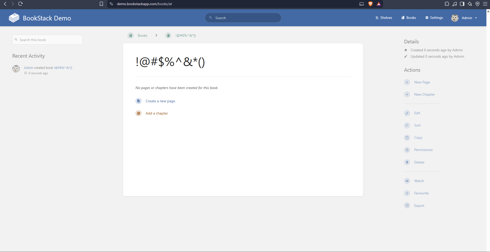

# Bug Report: BookStack Demo

| Item | Details |
|---|---|
| Application | BookStack Demo (https://demo.bookstackapp.com/) |
| Environment | Public demo instance, Chrome browser |
| Tester | _Fuad Hasan_ |
| Test Date | 2026-10-27 |
| Evidence folder | [`evidences/`](evidences) |

## Bug Summary

| Bug ID | Title | Module | Severity | Priority | Reproducibility | Status |
|---|---|---|---|---|---|---|
| [BUG-001](#bug-001-duplicate-book-names-accepted-without-warning) | Application allows creation of multiple books with identical names without any warning or confirmation | Book Management: Create Book | Medium | High | 100% | Open |
| [BUG-002](#bug-002-special-character-only-book-name-generates-a-non-descriptive-url-slug) | Creating a book with only special characters generates a cryptic, non-descriptive URL slug | Book Management: URL slug generation | Low | Medium | 100% | Open |

---

## BUG-001: Duplicate book names accepted without warning

**Severity:** Medium | **Priority:** High | **Reproducibility:** 100% | **Status:** Open | **Linked test case:** TC-016

### Description
BookStack lets a user create several books with exactly the same name and shows no warning, confirmation prompt or validation error. The system silently adds a random alphanumeric suffix to the URL slug to avoid a routing collision, but the books still appear in the interface with identical names. This leads to user confusion and makes content harder to organise.

### Preconditions
1. User is authenticated as Admin (`admin@example.com`).
2. At least one book already exists in the system.

### Steps to Reproduce
1. Go to https://demo.bookstackapp.com/login.
2. Log in with email `admin@example.com` and the demo password.
3. Go to https://demo.bookstackapp.com/create-book.
4. Enter `Bug Verification Book` in the **Name** field.
5. Click **Save Book**.
6. Verify the book is created successfully (URL: `/books/bug-verification-book`).
7. Go to https://demo.bookstackapp.com/create-book again.
8. Enter `Bug Verification Book` in the **Name** field (exact same name).
9. Click **Save Book**.
10. Observe that the second book is created without any warning or error.
11. Go to https://demo.bookstackapp.com/books to view the book listing.

### Expected Result
One of the following should happen:
- **Option A (preferred):** a warning such as "A book with this name already exists. Do you want to continue?" that requires explicit confirmation before a duplicate is created.
- **Option B:** a validation error prevents creation ("A book with this name already exists. Please choose a different name.").
- **Option C:** the duplicate name is accepted but clearly differentiated, with a visible notification or an automatic change such as appending "(2)" to the display name.

### Actual Result
- The second book is created silently, with no warning, confirmation or validation feedback.
- Both books appear in the book listing with identical display names.
- The only difference is the URL slug:
  - Book 1: `https://demo.bookstackapp.com/books/bug-verification-book`
  - Book 2: `https://demo.bookstackapp.com/books/bug-verification-book-Zfq`
- Users browsing the list cannot visually tell the two books apart.
- The random suffix (`-Zfq`) is not user-friendly and gives no meaningful differentiation.

### Evidence
Folder: [`evidences/bug001`](evidences/bug001)

| Screenshot | Shows |
|---|---|
| [`bug_verification_book_1_1793056988910.png`](evidences/bug001/bug_verification_book_1_1793056988910.png) | First book created with the name "Bug Verification Book" |
| [`bug_verification_book_2_1793057003900.png`](evidences/bug001/bug_verification_book_2_1793057003900.png) | Second book created with the identical name, no warning shown |
| [`duplicate_books_listing_1793057008959.png`](evidences/bug001/duplicate_books_listing_1793057008959.png) | Books listing showing both identically named books |
| [`duplicate_books_grid_1793057014674.png`](evidences/bug001/duplicate_books_grid_1793057014674.png) | Grid view showing the duplicate entries |

---

## BUG-002: Special-character-only book name generates a non-descriptive URL slug

**Severity:** Low | **Priority:** Medium | **Reproducibility:** 100% | **Status:** Open | **Linked test case:** TC-017

### Description
When a book name consists only of special characters (for example `!@#$%^&*()`), the system strips the special characters while building the URL slug. This produces a meaningless slug (`at`). The book is created successfully, but the resulting URL gives no indication of its content.

### Preconditions
1. User is authenticated as Admin.

### Steps to Reproduce
1. Go to https://demo.bookstackapp.com/create-book.
2. Enter `!@#$%^&*()` in the **Name** field.
3. Click **Save Book**.
4. Observe the URL of the created book.

### Expected Result
The system should either:
- reject the name with a validation message (for example "Book name must contain at least one alphanumeric character"), or
- generate a meaningful fallback slug (for example `book-<timestamp>` or `untitled-book`).

### Actual Result
- The book is created successfully with the special-character name.
- The generated slug is cryptic and non-descriptive: `https://demo.bookstackapp.com/books/at`.
- The slug has no meaningful relationship to the book name.
- Users sharing or bookmarking this URL would find it meaningless.

### Evidence
Folder: [`evidences/bug002`](evidences/bug002)

| Screenshot | Shows |
|---|---|
| [`special_chars_book_cryptic-url.png`](evidences/bug002/special_chars_book_cryptic-url.png) | Book page with the special-character name and the cryptic URL `/books/at` |

